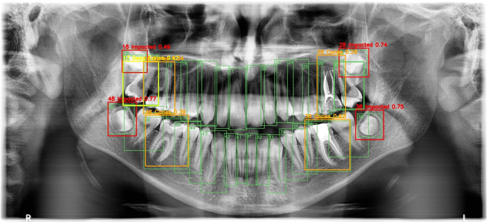
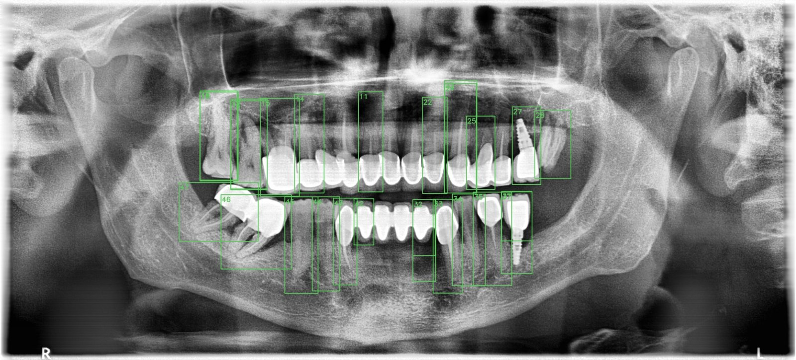

# Dental X-ray Charting with YOLOv8 (DENTEX)

Automatic tooth numbering and diagnosis on panoramic dental X-rays. Two YOLOv8s models run on the same X-ray: one finds and numbers all 32 teeth (FDI system, 11 to 48), the other detects four findings (caries, deep caries, periapical lesion, impacted tooth). Each finding is then mapped to its tooth, so the output reads like a dental chart:

```
Tooth 16: Caries (0.34)
Tooth 17: Deep Caries (0.42)
Tooth 18: Impacted (0.49)
Tooth 36: Caries (0.62)
Tooth 48: Impacted (0.77)
```



Both models are exported to ONNX and checked with ONNX Runtime.

Built on the [DENTEX](https://huggingface.co/datasets/ibrahimhamamci/DENTEX) dataset from the MICCAI 2023 challenge: panoramic X-rays from three hospitals with different machines and protocols.

## Pipeline

1. **Data prep.** COCO annotations converted to YOLO format, CLAHE contrast enhancement on every X-ray, random 85/15 train/validation split.
   - Tooth model: the quadrant-enumeration set (634 X-rays, every tooth boxed), 32 FDI classes.
   - Diagnosis model: the quadrant-enumeration-diagnosis set (705 X-rays, abnormal teeth boxed), 4 classes. The FDI tooth of each finding is kept for evaluation.
2. **Training.** YOLOv8s, 1024 px, cosine LR, early stopping (patience 25). Both models train in parallel, one per GPU, on Kaggle's 2x T4. Total training time: 34 minutes.
3. **Evaluation.** Per-class precision, recall, F1, mAP@0.5 and mAP@0.5:0.95 on the validation split.
4. **Charting.** Each finding is assigned to the predicted tooth box that covers the largest share of it.
5. **Export.** Both models exported to ONNX (opset 12, simplified) and tested with ONNX Runtime on CPU.

## Results (validation split)

**Diagnosis model** (105 X-rays, 512 findings)

| Class | Precision | Recall | F1 | mAP@0.5 | mAP@0.5:0.95 |
|---|---|---|---|---|---|
| Impacted | 0.849 | 0.910 | 0.878 | 0.916 | 0.569 |
| Deep caries | 0.638 | 0.463 | 0.537 | 0.564 | 0.364 |
| Caries | 0.467 | 0.536 | 0.499 | 0.529 | 0.383 |
| Periapical lesion | 0.576 | 0.440 | 0.499 | 0.406 | 0.260 |
| **All** | **0.633** | **0.587** | **0.609** | **0.604** | **0.394** |

**Tooth numbering model** (95 X-rays, 2,771 teeth)

| | Precision | Recall | mAP@0.5 | mAP@0.5:0.95 |
|---|---|---|---|---|
| All 32 teeth | 0.926 | 0.929 | 0.960 | 0.565 |

The lowest recall is on the premolars (14, 15, 24, 25: recall 0.81 to 0.84) and tooth 16. Neighboring premolars look very similar, so the model sometimes swaps them.

**Charting:** ground-truth findings land on the correct tooth 88.7% of the time (455 of 513) using the predicted tooth boxes.

## How this compares to the DENTEX challenge

The best diagnosis results published for the challenge are mAP@0.5 = 0.602 and mAP@0.5:0.95 = 0.376 (HierarchicalDet baseline, [paper](https://arxiv.org/abs/2305.19112)). This model reaches 0.604 and 0.394 on its own validation split, so it lands in the same range with a plain YOLOv8s.

This is not a like-for-like comparison. The challenge numbers come from the official hidden test set (250 X-rays). Mine come from a 105-image split of the training data that was also used to pick the best checkpoint, which makes them somewhat optimistic.

## Design choices

- **CLAHE preprocessing.** Panoramic X-rays have low local contrast around the crowns and roots. CLAHE boosts local contrast without amplifying noise across the whole image.
- **No horizontal flip for the tooth model.** Flipping a panoramic X-ray swaps the patient's left and right, so tooth 36 would appear where 46 is while keeping the label 36. Flips stay on for the diagnosis model, where the labels don't depend on side.
- **Two models instead of one.** The diagnosis set only boxes abnormal teeth, so it can't teach numbering for healthy teeth. A separate numbering model trained on fully labeled X-rays fixes that.
- **Parallel training.** The two models train at the same time, one per T4 GPU, which halves the wall-clock time.
- **ONNX export.** Smaller deployment footprint and runs on CPU with ONNX Runtime, no PyTorch needed.

## What's hard and what I'd do next

Impacted teeth are large, high-contrast shapes, so they are easy. Caries are small and subtle, the line between caries and deep caries is partly a matter of clinical judgment, and periapical lesions have only 133 training examples. Panoramic X-rays are also not the best view for caries; bitewings are.

The tooth model also struggles on heavily restored mouths. On the X-ray below (crowns, a bridge, implants and missing teeth) it produces overlapping boxes and shifts the numbering on the lower right side, because the gaps break the "count from the midline" pattern it learned.



Next steps:
- Handle missing teeth and restorations explicitly: suppress overlapping tooth boxes per FDI number and check that numbering stays in order along each arch.
- Two-stage pipeline: crop each tooth with the numbering model, then classify findings on the crop at higher resolution.
- More data for the rare classes, plus class-weighted loss.
- Tune the confidence threshold toward recall, since a missed lesion is worse than a false flag that a dentist rejects.
- Evaluate on the official DENTEX test set and validate across sites.

## Run it

The notebook is written for Kaggle:

1. Attach the DENTEX training data as a dataset (the notebook searches `/kaggle/input` for `train_quadrant_enumeration.json` and `train_quadrant_enumeration_disease.json`).
2. Settings: GPU T4 x2, Internet on.
3. Save & Run All. Outputs land in `/kaggle/working/models` (`.pt` and `.onnx`), `results` (metrics CSVs, dental charts JSON) and `demo` (overlay images).

It also runs on a single GPU; the two models then train one after the other.

## API (Modal, CPU, ONNX Runtime)

`deploy/` serves both ONNX models behind a FastAPI endpoint on [Modal](https://modal.com). It runs on CPU only and uses ONNX Runtime with its own letterbox, YOLOv8 decoding and NMS, so the container has no PyTorch or Ultralytics and starts fast.

| Endpoint | What it returns |
|---|---|
| `GET /health` | Status and loaded class names |
| `POST /predict` | JSON: dental chart lines, findings with FDI tooth + confidence + box, all detected teeth, inference time |
| `POST /predict/image` | The X-ray with numbered teeth and findings drawn on it (JPEG) |

Both POST endpoints take the X-ray as a multipart `file` and optional `conf` (default 0.25) and `iou` (default 0.7) query parameters.

Deploy:

```bash
pip install modal
modal setup
modal volume create dentex-models
modal volume put dentex-models teeth_yolov8s.onnx /teeth_yolov8s.onnx
modal volume put dentex-models diag_yolov8s.onnx /diag_yolov8s.onnx
modal deploy deploy/modal_app.py
```

Call it:

```bash
curl -X POST "https://<your-modal-url>/predict" -F "file=@panoramic.png"
curl -X POST "https://<your-modal-url>/predict/image" -F "file=@panoramic.png" -o charted.jpg
```

Response shape (values are illustrative):

```json
{
  "teeth_detected": 28,
  "chart": ["Tooth 36: Caries (0.62)", "Tooth 48: Impacted (0.77)"],
  "findings": [{"tooth": "36", "diagnosis": "Caries", "confidence": 0.62, "overlap": 0.94, "box": [1251, 492, 1437, 697]}],
  "inference_ms": 1850
}
```

Research demo only, not a medical device.

## Data and license

DENTEX is released under [CC BY-NC-SA 4.0](https://creativecommons.org/licenses/by-nc-sa/4.0/) for non-commercial research. This repo contains no images from the dataset.

```
@article{hamamci2023dentex,
  title={DENTEX: An Abnormal Tooth Detection with Dental Enumeration and Diagnosis Benchmark for Panoramic X-rays},
  author={Hamamci, Ibrahim Ethem and Er, Sezgin and Simsar, Enis and others},
  journal={arXiv preprint arXiv:2305.19112},
  year={2023}
}
```
